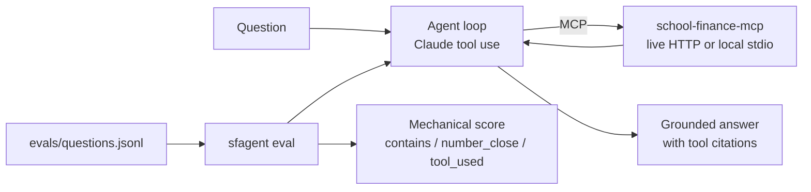

# school-finance-agent

[](https://github.com/tylermbeau-jpg/school-finance-agent/actions/workflows/ci.yml)

A Claude agent that answers California school-finance questions by calling real domain tools over the Model Context Protocol, plus a graded eval suite that keeps it honest.

This is the top of a stack I built end to end: [school-finance-mcp](https://github.com/tylermbeau-jpg/school-finance-mcp) exposes SACS account-string validation and school-meal reimbursement math as MCP tools (deployed live), and this repo puts an agent loop and an eval harness on top of it.



## Ask it something

```bash
git clone https://github.com/tylermbeau-jpg/school-finance-agent.git
cd school-finance-agent
python3 -m venv .venv && .venv/bin/pip install -e ".[dev]"
export ANTHROPIC_API_KEY=sk-ant-...

.venv/bin/sfagent ask "Decode 13-5310-0-0000-3700-4700 and tell me what fund it hits."
.venv/bin/sfagent ask "500 free and 200 paid lunches with the CA top-up: total reimbursement?"
```

By default the agent talks to the live deployed MCP server. `--stdio` spawns a local copy instead, and `--model` picks the Claude model.

The system prompt forbids answering SACS or reimbursement questions from memory: every factual claim must come from a tool result. Question 11 of the eval suite exists to check the refusal side of that rule (a question the tools cannot answer, graded on the agent saying so).

## The eval suite

```bash
.venv/bin/sfagent eval
```

Twelve graded questions in [evals/questions.jsonl](evals/questions.jsonl), each with mechanical checks:

- `contains`: required substrings, case-insensitive
- `number_close`: a number in the answer within tolerance of the expected value (handles $ and comma formatting)
- `tool_used`: the agent actually called the named tool, not answered from memory

The runner prints per-question PASS/FAIL with the specific failed checks and exits nonzero unless everything passes, so it drops straight into CI once you give CI a key. Grading is deliberately mechanical: if a check would need judgment, it belongs in a different harness.

## What is tested without an API key

`pytest -q` runs twelve tests with no key and no paid calls: the scorer (every check type, pass and fail paths), the questions file's schema, and integration tests that run the REAL MCP server over stdio (tool listing through the bridge, a real tool execution, and the full agent loop driven by a scripted stub LLM that requests a tool call and must receive the genuine tool result back).

Stated plainly: the live-model path (`ask` and `eval` with a real key) exercises the same loop code the stub covers, but the graded eval scores in this README's history were not produced in CI. Run `sfagent eval` with your key to produce your own.

## Why this shape

The agent, the tools, and the evals are three separate layers on purpose. The MCP server is useful to any MCP client, not just this agent. The agent loop is model-mediated glue, and the injectable client keeps it testable. The evals are the layer most agent demos skip, and the one that turns "it seemed to answer well" into a number you can watch across prompt and model changes.

## License

MIT. See LICENSE.
